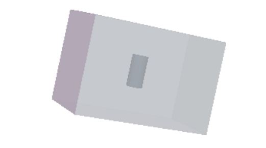
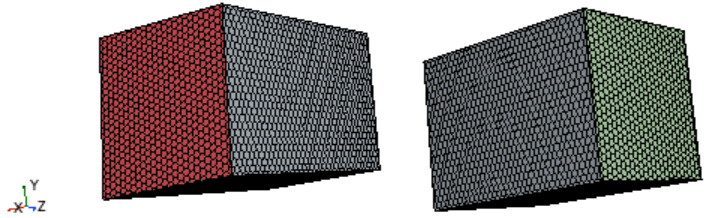
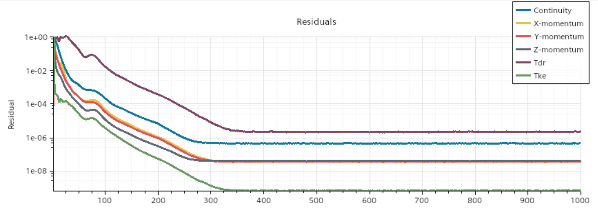
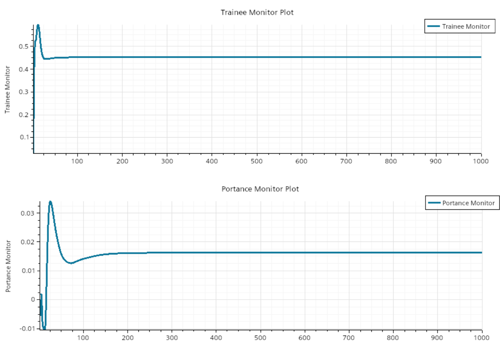
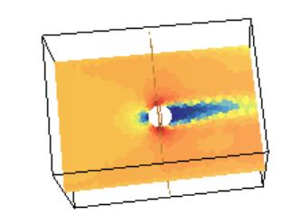
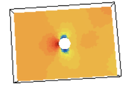

# 3D Flow Around a Cylinder — STAR-CCM+ CFD Study

Steady RANS simulation of the air flow around a finite circular cylinder at 10, 15, 20 and 50 m/s with STAR-CCM+: convergence checks, velocity and pressure fields, drag and lift coefficients, and a consistency check of the computed forces against the V² law.

**Author:** Yanis Boutabia — *IPSA Paris, CFD lab report (in French), February 2025.*

## Objective

Simulate the 3D flow around a cylinder in air to study the aerodynamic forces (drag and lift) and how they depend on the inflow speed. The lab covers the full CFD workflow: geometry, meshing, physics set-up, solving and post-processing.

## Set-up

- **Geometry:** cylinder of diameter D = 0.05 m and height H = 0.1 m, inside a 0.292 × 0.420 × 0.292 m domain
- **Fluid / flow:** air, ρ = 1.225 kg/m³, incompressible and steady
- **Turbulence:** two-equation RANS model (transport equations for turbulent kinetic energy *Tke* and dissipation rate *Tdr*, both monitored in the residuals)
- **Boundary conditions:**
  - Inlet: imposed velocity V∞ = 10, 15 and 20 m/s (plus an additional 50 m/s run)
  - Outlet: atmospheric pressure
  - Lateral and top walls: slip
  - Cylinder wall and bottom wall: no-slip
- **Reynolds number** (computed from D and air ν ≈ 1.5×10⁻⁵ m²/s): from about 3.3×10⁴ at 10 m/s to 1.7×10⁵ at 50 m/s

*Computational domain containing the cylinder (shown transparent)*

*Volume mesh — view on the inlet face (red) and on the outlet face (green)*

## Convergence

The 10, 15 and 20 m/s cases were run for 1000 iterations. The residuals of continuity and momentum drop and plateau after about 200–400 iterations. At 10 m/s the turbulent kinetic energy residual falls below 10⁻⁸ while the dissipation residual stays at a higher level. At 20 m/s the dissipation residual keeps fluctuating, which the report attributes to unsteady vortex structures in the wake despite the steady formulation. The drag and lift coefficients settle to constant values after roughly 100–150 iterations.

*Residuals at V∞ = 10 m/s*

*Drag coefficient (top) and lift coefficient (bottom) versus iteration, V∞ = 10 m/s*

## Flow fields

On the horizontal and vertical cut planes, the flow decelerates at the stagnation point on the upstream face, accelerates around the sides, and develops a recirculating wake downstream of the cylinder. The pressure is highest at the stagnation point and drops on the sides and in the wake, so the drag comes from the pressure difference between the front and the rear of the cylinder, together with skin friction on the wall.

*Velocity magnitude on a horizontal plane through the cylinder, V∞ = 10 m/s — the wake develops downstream*

*Static pressure on a horizontal plane through the cylinder, V∞ = 10 m/s*

## Aerodynamic coefficients and forces

| V∞ (m/s) | Re (approx.) | C_D | C_L | Drag (N) | Lift (N) |
|---|---|---|---|---|---|
| 10 | 3.3×10⁴ | 0.4517 | 0.0162 | 0.138 | 0.0019 |
| 15 | 5.0×10⁴ | 0.4518 | 0.0120 | 0.311 | 0.0033 |
| 20 | 6.7×10⁴ | 0.4525 | 0.0118 | 0.554 | 0.0057 |
| 50 | 1.7×10⁵ | 0.4460 | 0.0219 | 3.415 | 0.0656 |

- **C_D is nearly independent of speed** between 10 and 20 m/s (variation below 0.2%) and about 1.3% lower at 50 m/s.
- **Lift is negligible.** The lift force stays between 1% and 2% of the drag force at every speed, as expected for a symmetric body in a uniform flow. The small variations of C_L with speed are small in absolute terms and should not be over-interpreted.
- **Forces follow the V² law.** Relative to 10 m/s, the drag is ×2.25, ×4.01 and ×24.7 at 15, 20 and 50 m/s (theory: ×2.25, ×4, ×25; the small deficit at 50 m/s comes from the slightly lower C_D).
- **Consistency check of the force tables.** F = ½·ρ·V²·S·C reproduces the drag values exactly with S = D·H = 5.0×10⁻³ m², and the lift values with S ≈ 1.96×10⁻³ m² (≈ πD²/4). These reference areas are inferred from the tables, so C_D and C_L are normalized with different areas and should not be compared directly.

## Limitations and possible extensions

- The absolute C_D and C_L values were not compared with experimental or literature data in this lab (as the report itself points out in its conclusion). The results are best read as a numerical study of trends, not as a validated prediction.
- A steady-state formulation cannot resolve vortex shedding. An unsteady simulation (URANS or LES) would be the natural next step to study the wake.
- A mesh-independence study and a comparison with measurements or reference data would complete the validation.

## Tools

`STAR-CCM+` — geometry, meshing, physics set-up, solving, post-processing

---
*Academic lab report — IPSA Paris, February 2025.*
